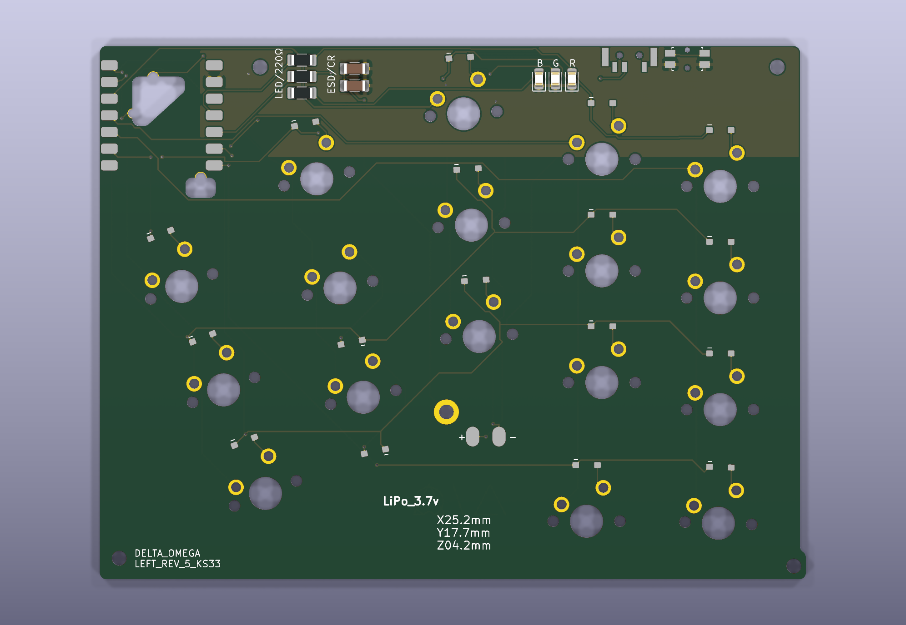

[English](BUILD_GUIDES.md) | [简体中文](BUILD_GUIDES.zh-CN.md)

# Build Guides

This document covers the **hand-solder version** of the build process.

## Required Tools and Materials
- Soldering iron
- Solder wire
- Flux
- Ventilation system
- Knife or precision cutter
- Silicone adhesive or cyanoacrylate (For magnets)
- Multimeter

If working with a mouse-bited PCB, you will also need:
- Plier
- Mask
- Sandpaper

⚠️ **Note**: Be cautious when sanding PCBs. Fine dust can be hazardous.

> [!CAUTION]
> Always prioritize safety. Proper ventilation, a clean workspace, and appropriate protective equipment are **mandatory**, not optional.

## Power Switch

1. Apply solder to one of the wide pads.
2. Place the switch in position and hold it while reflowing the solder to tack it in place.
3. Solder the opposite wide pad.
4. Finally, solder the three smaller legs.

Correct alignment is essential (the boss features will help position the part).

> [!CAUTION]
> Keep the switch in the **OFF position (all the way to the right)** during the entire build. This is critical.

## Reset Switch

The process is nearly identical to the power switch:

1. Pre-solder one pad.
2. Position the switch and reflow to hold it in place.
3. Solder the remaining three pads.

As with the power switch, correct alignment is important (boss features assist here).

## (Optional) LED

1. LEDs are polarized components. Even if the LEDs are of the same size, different manufacturers may indicate polarity in different ways. Refer to the corresponding datasheet to confirm the correct polarity before soldering. Align the LED according to the silkscreen markings, where the closed side represents the negative (–) terminal and the open side represents the positive (+) terminal.
2. Apply solder to one pad, then reflow it while positioning the LED to secure it in place. After that, solder the opposite pad.
3. The color of the LED may be selected and installed according to user preference. For reference, the MCU pins corresponding to each silkscreen text (R, G, B) are connected identically on both the left and right sides.

> [!CAUTION]
> LEDs are highly sensitive to heat. Ensure that you verify the proper soldering temperature and limit the soldering duration to prevent damage.

### LED Resistors

1. Install three resistors for the LEDs. These components are non-polarized and therefore have no orientation requirements.
2. Apply solder to one pad, place the resistor in position, and reflow the solder to secure it. Then proceed to solder the remaining pad.

## (Optional) ESD Protection

1. Install the capacitor and resistor for ESD protection. There are two available mounting positions, and either component (capacitor or resistor) may be placed in either location. Both are non-polarized.

2. As with previous components, apply solder to one pad, position the part, and reflow the solder to secure it. Then proceed to solder the remaining pad.

## Diodes

Rev5 uses one **SOD-323 1N4148WS** diode per key. The diode is outside the
switch body so it does not interfere with the KS-33 housing.

1. Orientation is critical. Align the cathode marking with pad 1 and the PCB silkscreen.
2. Tin one pad, place the diode, then solder the second pad.
3. Inspect each joint under magnification before installing switches.

## Switches

Rev5 uses direct-solder Gateron KS-33 Low Profile 3.0 switches. It does not use
hot-swap sockets.

1. Dry-fit each switch before soldering. All five posts must enter without force.
2. Confirm the switch is fully seated and the stem is not rotated.
3. Solder one electrical pin from the PCB backside, then check alignment.
4. Solder the second electrical pin.
5. Do not fill the center or locator holes with solder.
6. Trim both electrical pins to no more than 0.5 mm below the PCB, then
   insulate any exposed metal before fitting the bottom cover.

- The center hole is 5.0 mm.
- The two locator holes are 1.70 mm at ±5.08 mm.
- The two electrical pins use standard MX coordinates.
- The electrical pins are 3.0 mm long, so a 1.6 mm PCB leaves about 1.4 mm
  protruding before trimming.

> [!TIP]
> After each switch, use continuity/diode mode to verify the switch and its
> series diode. This is much easier before the case is assembled.

## MCU Controller

1. **Flash firmware first** to verify the MCU is functional.

2. Position the MCU. If needed, insert header pins in the top-right and bottom-left corners for stability. (Remove after soldering)

3. Solder the castellated edges of the XIAO to the PCB pads.

⚠️ When soldering along the **outer edge (left side of the left PCB)**:
- Apply only minimal solder.
- Avoid bridges that may contact the aluminum case.

4. On the PCB backside, solder the 2 additional connection points. (Battery and Reset)
5. As with the switches, ensure solder bonds to both the XIAO and PCB.

6. (Optional) If you intend to use the LED, solder the additional pin located below.

## Battery

> [!CAUTION]
> Confirm the power switch is **OFF** before beginning.

> [!WARNING]
> Lithium-polymer (LiPo) batteries are hazardous. Even minor damage can lead to thermal runaway. Prevent shorts, punctures, or impacts. Mishandling can cause severe injury or damage to components.

1. This design does not use JST or Molex connectors. Wires are soldered directly.
2. Trim wires to length. Strip 1–2 mm of insulation and tin the exposed ends.
3. Double-check polarity (red = positive, black = negative).
4. Insulate the positive terminal with RTV silicone, Kapton tape, or another reliable method.

## (Optional) Magnet

Install magnets so that the polarity between the left and right cases is **aligned correctly**. ensuring they attract each other when closed.

Secure the magnets in place using **silicone adhesive** or **cyanoacrylate (instant glue)**.

## Case Assembly

1. Tilt the case slightly backward.
2. Align the rear ports first, then lower the front into place.

3. Fasten the PCB to the case using screws. Tightening should be firm but not excessive.
4. If using a cover plate, place it before fastening screws.

## Finish!

Your build is now complete!
