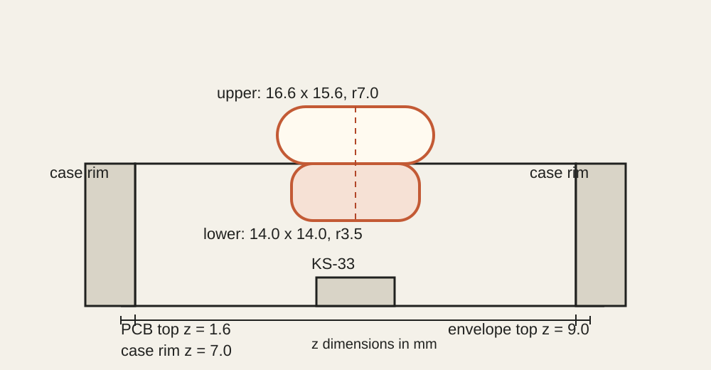

[English](MECHANICAL.md) | [简体中文](MECHANICAL.zh-CN.md)

# Rev5 机械说明

Rev5 使用 Gateron KS-33 Low Profile 3.0 五脚轴。Rev5 外壳保留 Rev2 外形和螺丝孔位，并为每个轴位增加 `15.2 mm`、`r1.8 mm` 少量让位。该圆角可由常规 CNC 铣刀加工，并匹配 KS-33 本体的圆角。

## 官方轴体尺寸

来源：[Gateron 图纸 `SPEC-KS-33B-014`](https://www.gateron.com/u_file/2610/12/file/GATERONKS-33LowProfile30MechanicalSilverSwitchSet.pdf)，版本 2，发布日期 2026-08-22。

| 项目 | 尺寸 |
|---|---:|
| 轴体本体 | 14.60 × 14.60 mm |
| PCB 以上本体高度 | 6.20 ± 0.05 mm |
| PCB 以上轴心总高度 | 13.10 mm |
| 中心孔 | 5.00 ± 0.10 mm |
| 定位孔 | 1.70 ± 0.05 mm，中心距 ±5.08 mm |
| 电气孔 | 1.50 ± 0.05 mm |
| 电气脚长度 | 3.00 mm |
| 定位柱长度 | 1.20 mm |

定位柱不会穿过 1.6 mm PCB。电气脚在轴体完全贴板后，会从 PCB 背面伸出约 1.4 mm；装底盖前必须剪短。

## 外壳复核结果

检查覆盖全部 34 个轴位，采用以下包络：

- PCB 顶面为 `z = 1.6 mm`
- 轴体包络为 `14.6 × 14.6 × 6.2 mm`，圆角半径 `r1.5 mm`
- 1u 键帽在 `z = 7.0 mm` 以下的底裙不超过 `14 × 14 mm`，圆角半径至少 `r3.5 mm`
- 键帽在 `z = 7.0 mm` 以上不超过 `16.6 × 15.6 mm`，圆角半径至少 `r7.0 mm`



结果：轴体、键帽与 Rev5 外壳，以及全部相邻键帽之间均为零干涉。复核已包含正确的镜像旋转、可加工圆角和键帽之间的成对碰撞检查。

Rev5 外壳顶沿由 Rev2 的 `z = 7.0 mm` 提高到 `z = 8.8 mm`，与 `z = 9.0 mm` 的键帽包络顶部基本齐平，以获得更包覆的操作体感。生成器只将现有顶墙截面向上延伸，不对整壳做 Z 轴缩放，因此内部开口、螺丝柱和底部安装结构保持不变。

运行复核：

```bash
CADQUERY_SITE_PACKAGES=/path/to/cadquery/site-packages \
  /Applications/KiCad/KiCad.app/Contents/Frameworks/Python.framework/Versions/3.9/bin/python3.9 \
  case/scripts/check_rev5_clearance.py
```

允许的 1u 键帽空间另存为 `case/delta_omega_rev5_keycap_envelope.step`，坐标与外壳 STEP 一致，范围为 `z = 5.0` 至 `z = 9.0`。该文件只定义外形包络，不是可直接打印的键帽，也不包含 MX 轴心插孔。

## 直焊要求

1. 焊接前先干装，确认五个柱位无需用力即可全部进入。
2. 只焊接两个电气脚。
3. 从 PCB 背面将电气脚剪到剩余长度不超过 0.5 mm。
4. 检查是否存在锡尖，并在安装底盖或电池前用绝缘胶带、三防漆等覆盖裸露金属。
5. 不要强行压入定位柱，也不要向中心孔或定位孔填锡。

## 键帽限制

KS-33 使用 MX 兼容轴心，不代表任意 MX 键帽都能使用。`18 × 17 mm` 键距下，底裙和上部圆角必须落在上述包络内。方角键帽、标准 18 mm 键帽或按 19.05 mm 键距设计的键帽可能与外壳或相邻键帽干涉。

本 PCB 按直焊设计，没有热插拔座。
