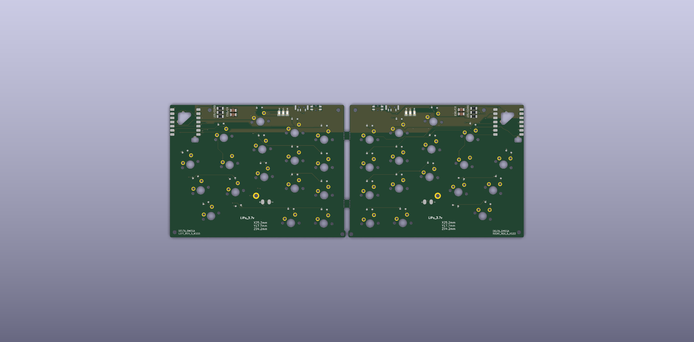

[English](README.md) | [简体中文](README.zh-CN.md)

# PCB

> [!TIP]
> If this is your first visit, please read the [Getting Started guide](./../docs/GETTING_STARTED.md) first.

---

## PCB List

| File | Description | Note |
|---|---|---|
| `delta-omega-rev5-ks33-left` | Rev5 left PCB for Gateron KS-33 LP 3.0 five-pin | Current version |
| `delta-omega-rev5-ks33-right` | Rev5 right PCB for Gateron KS-33 LP 3.0 five-pin | Current version |
| `delta-omega-rev5-ks33-both` | Rev5 left and right PCB with mouse-bite connection | Check panel separation before use |
| `delta-omega-rev4-handsolder-both` | Original ULP left and right PCB with mouse-bite connection | Legacy, not tested |
| `delta-omega-rev4-handsolder-left` | Original ULP left PCB | Legacy |
| `delta-omega-rev4-handsolder-right` | Original ULP right PCB | Legacy |
| `delta_omega_bottom_cover` | Bottom cover PCB plate | Reversible |
| `delta-omega-rev4-smd-both` | Original ULP SMD version | Legacy, not tested |

Rev5 uses a custom `Gateron_KS33_LP_3.0_5Pin` footprint:

- Standard MX electrical-pin positions
- 5.0 mm center hole
- 1.70 mm locator holes at ±5.08 mm
- Separate SOD-323 diode position outside the switch body

## Rev5 Verification

- KiCad DRC: 0 violations and 0 unconnected items for left, right, and panel
- 34 switches and 34 SOD-323 diodes total
- Two-layer 1.6 mm PCB, 0.2 mm minimum signal track width
- 0.2 mm copper-to-edge clearance outside the XIAO castellations
- XIAO edge-pad exception is scoped by the project `.kicad_dru` file
- Split ground-zone islands are connected with explicit tracks
- Gerbers, drill files, drill maps, and ZIP archives were regenerated from the
  checked-in Rev5 boards

The project has no KiCad schematic, so verification covers PCB connectivity,
matrix mapping, diode orientation, copper rules, and fabrication outputs rather
than schematic-to-PCB parity.

---

## How to Order

This guide is written based on **[JLCPCB](https://jlcpcb.com)**. While other PCB manufacturers may differ slightly, most ordering steps are very similar.

To place an order, upload the matching ZIP from [./gerbers/](./gerbers/).
For the current switch scheme, use the `rev5-ks33` archives.

---

### Recommended Options

| Specification     | Recommended                          | Notes                                                                 |
|-------------------|--------------------------------------|----------------------------------------------------------------------|
| Base Material     | FR-4                                 | Standard PCB substrate material                                      |
| Layers            | 2                                    | Two-layer board                                                      |
| PCB Quantity      | As many as needed                    |                                                                      |
| Product Type      | Industrial / Consumer Electronics    |                                                                      |
| Different Designs | 1                                    | If uploading a combined left & right PCB Gerber, select **2**.[^1]   |
| PCB Thickness     | 1.6 mm                               | Required for the 1.2 mm KS-33 locator pegs and 3.0 mm pins              |
| PCB Color         | Your preference                      |                                                                      |
| Surface Finish    | Your preference                      |                                                                      |
| Mark on PCB       | Remove Mark                          | Recommended for a cleaner finish                                     |

[^1]: If not selected, JLCPCB will automatically review your order and guide you to the correct option.
